# Karossy CRM schema

## Purpose

This is the implementation schema for the Karossy CRM and call-centre. It
extends the existing travel commerce database; it does not duplicate its
customer, booking, order, payment, role, or audit data.

## Source of truth already in the application

- `users`, `roles`, `permissions`: staff access and role-based control.
- `customers`: the single customer profile.
- `orders`, `bookings`, `payments`, `tickets`: commercial and travel fulfilment
  records.
- `service_enquiries`, `partner_enquiries`: inbound demand that may become a
  CRM lead.
- `analytics_events`, `audit_logs`: raw customer behaviour and administrative
  audit history.

## CRM entities to add

| Area | Tables | Notes |
| --- | --- | --- |
| Customer 360 | `customer_contacts`, `customer_tags`, `customer_tag` | Supports multiple phones/emails, companies, and segmentation without changing a customer's primary login email. |
| Sales | `crm_leads`, `crm_deals`, `crm_deal_contacts`, `crm_quotes`, `crm_quote_items`, `crm_commissions` | Leads can be converted to customers; deals can be tied to bookings, quotes, payments and staff. |
| Shared work | `crm_activities`, `crm_tasks`, `crm_attachments` | All notes, emails, meetings, tasks, internal comments and calls appear in one timeline. |
| Messaging | `notification_templates`, `notification_messages`, `notification_deliveries`, `automation_rules` | Keeps templates and delivery attempts separate, supporting email, SMS, WhatsApp and in-app delivery. |
| Promotions | `campaigns`, `promotion_codes`, `promotion_redemptions`, `campaign_audiences` | Existing public flight promotions remain intact; these tables manage CRM campaigns and their performance. |
| Call centre | `telephony_extensions`, `call_queues`, `call_queue_members`, `calls`, `call_participants`, `call_recordings`, `call_events` | First-party Karossy telephony data, designed for an Asterisk/WebRTC service later. |
| HR | `departments`, `employee_profiles`, `employee_departments`, `leave_requests`, `attendance_records`, `performance_targets` | An employee profile belongs to a user and controls department, manager and operational targets. |
| Integrations | `integration_connections`, `integration_sync_runs`, `integration_webhook_events` | Provider credentials are encrypted; webhooks are retained for safe retries and debugging. |

## Relationship map

```mermaid
erDiagram
    USERS ||--o| EMPLOYEE_PROFILES : has
    USERS ||--o{ CRM_LEADS : owns
    USERS ||--o{ CRM_DEALS : owns
    USERS ||--o{ CRM_ACTIVITIES : creates
    USERS ||--o{ CRM_TASKS : is_assigned
    USERS ||--o{ TELEPHONY_EXTENSIONS : uses
    USERS ||--o{ CALLS : handles
    DEPARTMENTS ||--o{ EMPLOYEE_DEPARTMENTS : contains
    EMPLOYEE_PROFILES ||--o{ EMPLOYEE_DEPARTMENTS : belongs_to
    EMPLOYEE_PROFILES ||--o{ LEAVE_REQUESTS : requests
    EMPLOYEE_PROFILES ||--o{ ATTENDANCE_RECORDS : records
    EMPLOYEE_PROFILES ||--o{ PERFORMANCE_TARGETS : receives

    CUSTOMERS ||--o{ CUSTOMER_CONTACTS : has
    CUSTOMERS ||--o{ CUSTOMER_TAGS : uses
    CUSTOMER_TAGS ||--o{ CUSTOMER_TAG_LINKS : categorises
    CUSTOMERS ||--o{ ORDERS : places
    ORDERS ||--o{ BOOKINGS : contains
    ORDERS ||--o{ PAYMENTS : receives
    BOOKINGS ||--o{ TICKETS : issues

    CRM_LEADS }o--o| CUSTOMERS : converts_to
    CRM_LEADS ||--o{ CRM_DEALS : qualifies
    CRM_DEALS ||--o{ CRM_DEAL_CONTACTS : includes
    CUSTOMERS ||--o{ CRM_DEAL_CONTACTS : relates
    CRM_DEALS ||--o{ CRM_QUOTES : proposes
    CRM_QUOTES ||--o{ CRM_QUOTE_ITEMS : contains
    CRM_DEALS }o--o{ BOOKINGS : results_in
    CRM_DEALS ||--o{ CRM_COMMISSIONS : earns

    CUSTOMERS ||--o{ CRM_ACTIVITIES : timeline
    BOOKINGS ||--o{ CRM_ACTIVITIES : timeline
    CRM_DEALS ||--o{ CRM_ACTIVITIES : timeline
    CRM_ACTIVITIES ||--o{ CRM_ATTACHMENTS : has
    CRM_TASKS }o--o| CUSTOMERS : concerns
    CRM_TASKS }o--o| BOOKINGS : concerns
    CRM_TASKS }o--o| CRM_DEALS : concerns

    NOTIFICATION_TEMPLATES ||--o{ NOTIFICATION_MESSAGES : renders
    NOTIFICATION_MESSAGES ||--o{ NOTIFICATION_DELIVERIES : attempts
    AUTOMATION_RULES ||--o{ NOTIFICATION_MESSAGES : triggers
    CAMPAIGNS ||--o{ PROMOTION_CODES : owns
    PROMOTION_CODES ||--o{ PROMOTION_REDEMPTIONS : redeems
    BOOKINGS ||--o{ PROMOTION_REDEMPTIONS : applies

    CALL_QUEUES ||--o{ CALL_QUEUE_MEMBERS : assigns
    TELEPHONY_EXTENSIONS ||--o{ CALL_QUEUE_MEMBERS : joins
    CUSTOMERS ||--o{ CALLS : calls
    BOOKINGS ||--o{ CALLS : relates
    CRM_DEALS ||--o{ CALLS : relates
    CALLS ||--o{ CALL_PARTICIPANTS : contains
    CALLS ||--o{ CALL_RECORDINGS : stores
    CALLS ||--o{ CALL_EVENTS : logs
    CALLS ||--o{ CRM_ACTIVITIES : creates

    INTEGRATION_CONNECTIONS ||--o{ INTEGRATION_SYNC_RUNS : runs
    INTEGRATION_CONNECTIONS ||--o{ INTEGRATION_WEBHOOK_EVENTS : receives
```

## Non-negotiable design rules

1. **One customer record.** A call, booking, lead, deal, message or task links
   to the existing `customers` table whenever the person is known.
2. **Money stays in current commerce tables.** CRM quotes estimate value;
   `orders` and `payments` remain the financial record of truth.
3. **Every action is traceable.** A call, note, status change, message,
   campaign redemption and assignment creates a timeline activity and audit log.
4. **Telephony is isolated.** The CRM calls a dedicated call service; it never
   exposes SIP credentials or directly controls PBX infrastructure from the web
   application.
5. **Sensitive data is protected.** Recording URLs, provider credentials and
   webhook payloads are access-controlled; secrets are encrypted at rest.
6. **Analytics reads facts; it does not own them.** Dashboards aggregate calls,
   bookings, payments, campaigns and activities. They do not create competing
   revenue or booking data.

## Delivery sequence

1. Customer contacts/tags, activities and tasks.
2. Leads, deals, quotes and commissions.
3. Calls, queues, extensions and call events.
4. Templates, notification deliveries, campaigns and promotion codes.
5. HR profiles, departments, attendance and targets.
6. Integration reliability and analytical roll-ups.

